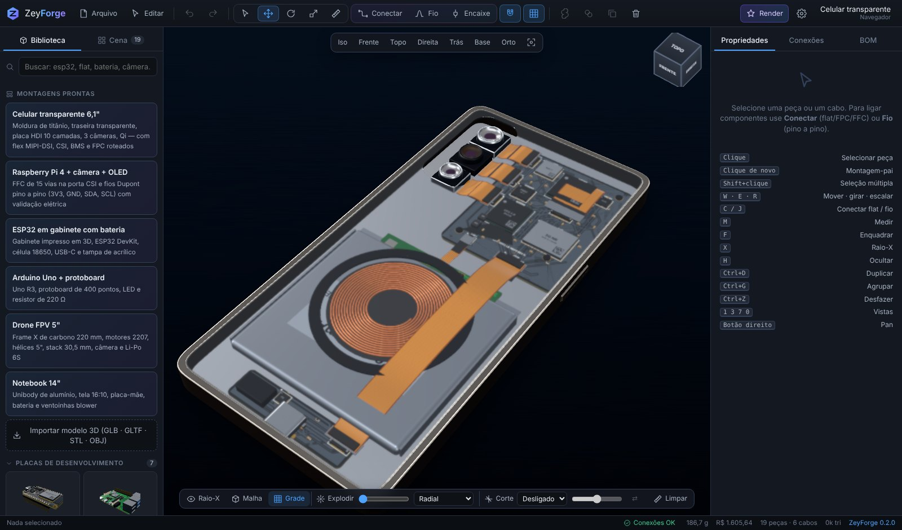
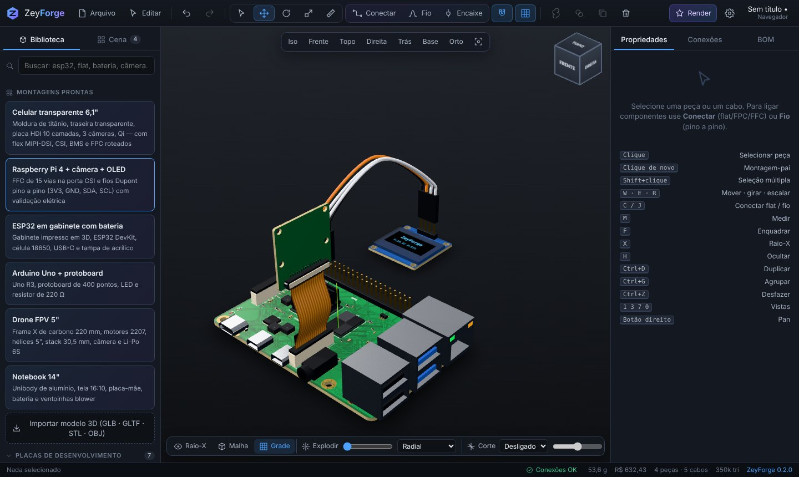

# ZeyForge — CAD 3D de hardware

O **ZeyForge** é um modelador 3D focado em **hardware eletrônico**. Com ele você monta celulares, notebooks, placas Arduino, ESP32 e Raspberry Pi, flats, conectores, baterias e chassis, com **render fotorrealista**, **conexões validadas** (flat por flat, fio por fio) e **lista de materiais com massa e custo**.

O mesmo código gera duas edições:

| Edição | Onde roda | Como |
|---|---|---|
| **Web (leve)** | Qualquer navegador e PWA instalável | `npm run build:web` → `dist/` (InfinityFree, GitHub Pages) |
| **Nativa (completa)** | Windows, Linux, macOS | **Tauri v2**: janela nativa, GPU dedicada, arquivos `.zeyforge` reais e associação de arquivo |
| **Nativa (completa)** | Android | **Capacitor**: APK com aceleração de GPU, salva em Documentos e compartilha |



---

## Recursos (v0.2)

**Render fotorrealista**
- HDRI de estúdio gerado pelo próprio app (faixas de luz de foto de produto, softbox, escuro dramático, luz do dia). Também dá pra girar, mudar a intensidade e a exposição.
- Sombras de contato, sombra direcional suave e oclusão de ambiente **GTAO** com SMAA (qualidade equilibrada ou máxima).
- Materiais físicos (PBR):
  - alumínio e titânio **escovados** com anisotropia real e micro-textura;
  - alumínio jateado;
  - vidro temperado com refração, dispersão e atenuação;
  - safira, policarbonato transparente, fibra de carbono 3K e solda SAC305.
- **PCBs com textura gerada:** plano de terra sob a máscara, trilhas com curvas de 45° em relevo, vias, pads ENIG/HASL, furos metalizados e silkscreen (referências, pinagens, contornos e pino 1).
- **Chips com marcação a laser** (part number, lote, Data Matrix) e blindagens RF com etiqueta.
- **Render por path tracing** (botão *Render*): iluminação global, reflexos múltiplos e refração real. Salva em PNG.

**Conexões profissionais**
- **Encaixes (sockets)** em cada componente, com pinagem real:
  - FPC/ZIF, MIPI-DSI, MIPI-CSI, BMS da bateria e board-to-board;
  - barras de pinos, JST, USB-C, furos de fixação, parafusos e espaçadores.
- **Conectar:** roteia **flat flex 3D**, uma fita real com largura, espessura e trilhas de cobre. Ela tem curvas suaves, torção distribuída, enrijecedores, contatos dourados e plug BTB. Também roteia fita IDC e cabo USB.
- **Fio:** liga pino a pino com fios Dupont nas cores convencionais.
- **Validação automática:**
  - tipo de conector, número de vias, passo e encaixe já ocupado;
  - **curto-circuito** 5 V / 3,3 V / VBAT ↔ GND, inclusive através de vários fios (netlist);
  - fontes diferentes interligadas e **5 V em GPIO de 3,3 V**;
  - **raio de dobra do flex abaixo da IPC-2223** e curva lateral impossível no plano da fita.
- **Encaixe magnético:** ao arrastar, plugs se alinham a receptáculos, barras macho a barras fêmea e parafusos ou espaçadores aos furos da placa.
- Pontos de passagem editáveis no cabo, netlist em CSV e comprimento de cada cabo.

**Biblioteca com medidas reais**
- **Placas:** ESP32 DevKit V1 (módulo WROOM-32 com blindagem e antena de PCB), Raspberry Pi 4 (portas completas, CSI/DSI de 15 vias, GPIO de 40 pinos), Raspberry Pi Pico, Arduino Uno R3 e Nano, PCB sob medida e protoboard.
- **Celular:** placa principal HDI com SoC PoP, UFS, PMIC, modem e blindagens. Tem também sub-placa USB-C, tela OLED (vidro 2.5D, polarizador, painel ligado, flex DSI com DDIC), câmeras com lentes multicamadas, bateria Li-Po com BMS, bobina Qi com ímãs, moldura de titânio com divisões de antena e traseira transparente.
- Conectores, passivos SMD/PTH, CIs (QFN, LQFP, BGA), parafusos, espaçadores, dissipadores, ventoinhas, motores FPV, hélices, servo e primitivas paramétricas.
- **Montagens prontas:** celular transparente (6 flex roteados), Raspberry Pi com câmera e OLED (FFC + fios), ESP32 em gabinete, kit Arduino, drone FPV 5" e notebook 14".

**Importação e exportação**
- Importa **GLB, GLTF, STL e OBJ**. Você escolhe a unidade (m, cm, mm ou polegadas) e vê a prévia do tamanho final em mm. O modelo é centralizado e apoiado no chão.
- **Editor de encaixes:** clique na superfície do modelo importado para criar conectores e definir tipo, vias, passo e terminação.
- Exporta **STL** (binário, Z-up, mm), **OBJ**, **GLTF/GLB** (metros, PBR preservado), **PNG**, **BOM (CSV)** e **netlist (CSV)**.
- Formato **`.zeyforge`**: contêiner ZIP com o projeto, os modelos importados e uma miniatura. Também abre projetos da v0.1.

**Engenharia e custos**
- **Massa em gramas:** vem da biblioteca para peças compradas, ou do **volume × densidade** do material para peças fabricadas e importadas. Inclui centro de massa, volume e área de superfície.
- **BOM:** quantidade, part number, fornecedor, massa e custo. A **precificação** considera montagem, embalagem, frete, impostos e margem, e calcula o preço sugerido e o lucro.
- Vista explodida (radial ou por camadas), corte por plano X/Y/Z, raio-X, malha, medição com ΔX/ΔY/ΔZ, booleanas (unir/subtrair/interseção), espelhar, padrão linear, agrupar e desfazer/refazer com histórico nomeado.



---

## Começando

```bash
git clone https://github.com/boymotos0123-web/zeyfoge.git
cd zeyfoge
npm install
npm run dev          # http://localhost:5173 (web)
```

| Comando | O que faz |
|---|---|
| `npm run dev` / `npm run dev:native` | Servidor de desenvolvimento (perfil web / nativo) |
| `npm run build:web` | Build leve para hospedagem → `dist/` |
| `npm run build:native` | Build completo para Tauri/Capacitor → `dist-native/` |
| `npm run check` | Typecheck + testes unitários (núcleo, conexões, BOM, arquivo) |
| `npm run desktop:dev` | App desktop em modo desenvolvimento (precisa de Rust) |
| `npm run desktop:build` | Instalador do seu sistema (`src-tauri/target/release/bundle`) |
| `npm run android:apk` | APK de debug (precisa de Android SDK + Java 21) |
| `npm run deploy:zip` | `zeyforge-web.zip` pronto para o InfinityFree |

### Instaladores automáticos (GitHub Actions)
No GitHub, abra **Actions → Release → Run workflow** (ou crie uma tag `v*`) e o GitHub compila tudo sozinho:
```bash
git tag v0.2.0
git push origin v0.2.0
```
O workflow **Release** gera um *draft* com o instalador de **Windows** (.msi/.exe), **Linux** (.deb/.AppImage/.rpm), **macOS** universal (.dmg), **Android** (.apk) e o **zeyforge-web.zip**. É só revisar e publicar.

### Hospedar a versão web
- **InfinityFree:** `npm run deploy:zip` → no *Online File Manager*, extraia o zip dentro de `htdocs/`. O `.htaccess` já vem com os tipos corretos.
- **GitHub Pages:** em *Settings → Pages → Source: GitHub Actions*. O workflow `pages.yml` publica a cada push na `main`.

### Requisitos para compilar os apps nativos localmente
- **Desktop:** [Rust](https://rustup.rs) + dependências do Tauri ([guia oficial](https://v2.tauri.app/start/prerequisites/)). No Linux: `libwebkit2gtk-4.1-dev libappindicator3-dev librsvg2-dev`.
- **Android:** Android Studio (SDK 36) e Java 21. Rode `npm run android:sync` e depois `npm run android:open`.

---

## Atalhos

`W` mover · `E` girar · `R` escalar · `Q` selecionar · `M` medir · `C` conectar flat · `J` fio · `F` enquadrar · `X` raio-X · `H` ocultar · `Del` excluir · `Ctrl+D` duplicar · `Ctrl+G` agrupar · `Ctrl+Z/Y` desfazer/refazer · `Ctrl+S` salvar · `Ctrl+I` importar · `1 3 7 0` vistas · `5` ortográfica.
Clique seleciona a peça. **Clique de novo** sobe para a montagem-pai. O botão direito faz pan.

## Documentação
- [Arquitetura](docs/ARCHITECTURE.md): módulos, fluxo de dados e decisões
- [Formato .zeyforge](docs/FILE-FORMAT.md)
- [Como criar componentes](docs/COMPONENTES.md)
- [Roadmap](docs/ROADMAP.md): próximas etapas (kernel B-Rep/STEP, KiCad, interferência, térmica)
- [Changelog](CHANGELOG.md)

## Licença
MIT © 2026 Zeylor. Bibliotecas de terceiros: three.js, three-mesh-bvh, three-bvh-csg, three-gpu-pathtracer (MIT), Preact (MIT), Tauri (MIT/Apache-2.0), Capacitor (MIT) e fflate (MIT).
